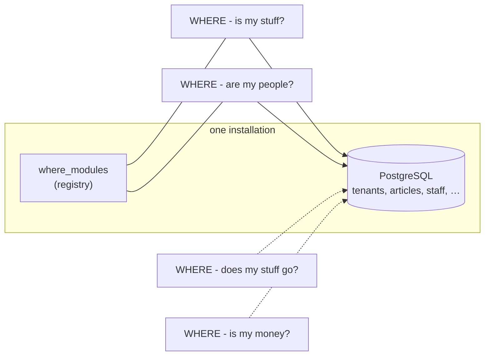

<div align="center">


**Warehouse logistics and operations software for theatre companies.**

[](LICENSE)
[](https://www.rust-lang.org)
[](https://svelte.dev)
[](https://www.postgresql.org)

</div>

WHERE keeps the warehouse of a theatre in order: articles, addresses, stock, incoming
goods, rentals and sales — plus the work that hangs off it, from orders to personnel
planning. It is a rebuild of a 4D-based ERP. The data model, the masks and the report
shapes follow the original, the technology does not: one Rust workspace, one Svelte
front end, one database.

It runs as a single workstation with an embedded PostgreSQL, or as workstations on a
central server. Both shapes use the same binaries; only the configuration differs.

## The products

WHERE is a family. Each product is an application of its own with its own name, its own
installer and its own bundle identifier — and all of them share one database and one set
of tenants.

| Product | What it does | Bundle identifier | Installer |
| --- | --- | --- | --- |
| **WHERE - is my stuff?** | Articles, addresses, stock, warehouses — the core | `de.where.warehouse` | yes |
| **WHERE - are my people?** | Employees, shifts, scheduling, holidays | `de.where.are-my-people` | yes |
| **WHERE - does my stuff go?** | Orders, package slips, rental and sale prices | — | in progress |
| **WHERE - is my money?** | Accounting, banks, invoices | — | in progress |

A module does not depend on another module. It brings its own database when it is the
first one installed and joins the existing one otherwise.

## One installation, one database

The first product that starts creates the database and is recorded as its owner
(`where_installation.database_owner`). Every later product finds that database and joins
it, together with its tenants. The registry of what is installed lives in `where_modules`.



A compiled-in module that is not installed answers `409` on its endpoints and hides its
menus, pages and fields. `Admin → Modulverwaltung` (`/admin/modules`) installs and removes
modules in the running application; the same actions exist on the command line:

```bash
cargo run -p where-server --bin where-installer -- --status
cargo run -p where-server --bin where-installer -- --module people
cargo run -p where-server --bin where-installer -- --remove money
```

A *tenant* is not a filter inside a mask but a database of its own — its own accounts,
rights, number series and file share. The rows of one installation's tenant register
describe the houses that belong together.

## Quick start

Everything on one machine, with a database that needs no installation — the development
preview starts an embedded PostgreSQL (PGlite), registers the modules, builds the API and
serves the SPA:

```bash
npm install --prefix tools
node tools/preview.mjs --no-open
```

| Address | What |
| --- | --- |
| <http://localhost:5173> | the application |
| <http://127.0.0.1:8090/api/v1/> | the API |
| <http://127.0.0.1:8090/swagger-ui> | OpenAPI |
| <http://127.0.0.1:8090/health> | health check |

Logs land in `data/logs/`. `node tools/preview.mjs --stop` stops the stack;
`--modules go,people` chooses another module set, `--no-modules` none.

With a PostgreSQL of your own, run the two halves separately:

```bash
cp .env.example .env            # point DATABASE_URL at your database
cargo run -p where-server       # applies the migrations on start

cd apps/web && npm install && npm run dev
```

## Build an installer

```bash
cd apps/desktop
npm install
npm run installer          # WHERE - is my stuff?   de.where.warehouse
npm run installer:people   # WHERE - are my people? de.where.are-my-people
```

Prerequisites, the central-server build, the configuration file and what each bundle
installs are described in [BUILD.md](BUILD.md). Every tagged release carries the
installers as assets; the workflow that builds them is in
[.github/workflows/release.yml](.github/workflows/release.yml).

## Roadmap

- **macOS and Linux installers.** The Tauri configuration already names the bundles, but
  only the Windows installers (MSI/NSIS) are built and tested today. macOS needs a macOS
  runner and a signing decision, Linux the WebKit GTK packages.
- **Installers for orders and accounting.** The backend and the pages of
  `WHERE - does my stuff go?` and `WHERE - is my money?` exist; their bundle identifiers
  and Tauri configurations follow.
- **Data migration from the legacy instance.** Taking over a running 4D installation is
  prepared through its REST interface, not ready for every table yet.

## Contributing

This repository is generated. Development happens in a private working repository; this
one receives its current state as a commit and is the place where releases are built.

That decides how contributions work:

- **Issues are welcome here.** Bug reports, screenshots and behaviour that differs from
  the original are the most useful contribution and are read.
- **Pull requests are not merged here.** A change is ported into the working repository,
  and it reappears in this repository with the next export, credited to its author in the
  commit message. Please open an issue first so the change is not written twice.

Code, comments, SQL, API and page paths are English; only the texts a user reads in the
application are German. Details, conventions and the checks to run: [CONTRIBUTING.md](CONTRIBUTING.md).

## Licence

[GNU Affero General Public License v3.0](LICENSE). You may use, study, change and
redistribute WHERE — and if you run a modified version as a network service, you have to
publish your changes under the same licence.

## Repository layout

```
crates/
  where-domain/         entities, value objects, errors — no infrastructure
  where-persistence/    SQLx repositories, migrations, legacy column mapping
  where-modules/        module manifests, installation registry, database ownership
  where-module-go/      "WHERE - does my stuff go?" backend
  where-module-people/  "WHERE - are my people?" backend
  where-module-money/   "WHERE - is my money?" backend
  where-api/            Axum router, DTOs, RFC 9457 errors, OpenAPI, authorization
  where-server/         binary, configuration, installer
apps/
  web/                  SvelteKit SPA — web, desktop and Android share one build
  desktop/              Tauri 2 shell and the bundles of the products
  mobile/               Android shell (kiosk WebView on one database)
modules/                one folder per product: manifest, documentation, front end
migrations/             the schema, applied on start
tools/                  development database, demo data, schema verification
logo/                   the icon every build takes its mark from
```

The schema keeps the table and column names of the legacy system — the data import
depends on them. Everything WHERE adds itself is English.
